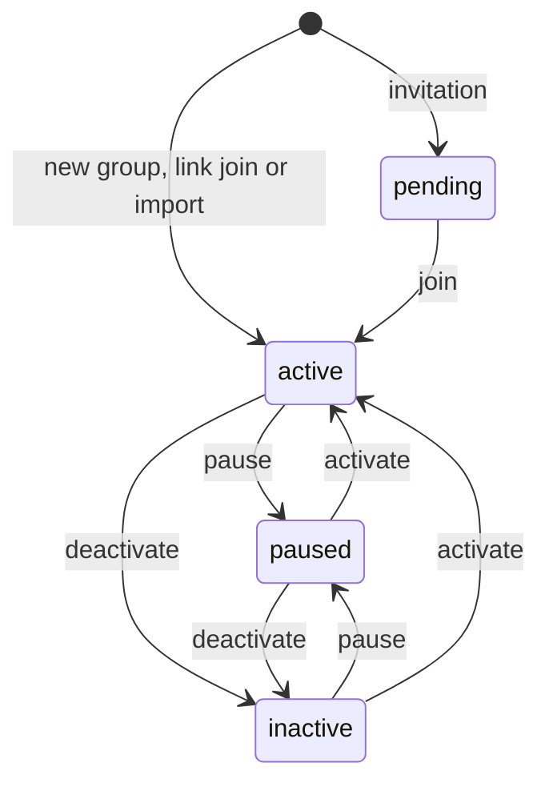

> 🤖 Written by AI --- read/modified by izkreny! 🤓

# Plan: record member status changes (#126)

## Approach

ADR 0008 (`docs/adr/2026-11-18_member-status-changes_0008.md`) is the design, and this plan only says how it lands. `state_machines-activerecord` and `state_machines-audit_trail` join the `Gemfile`, a `member_status_changes` table holds one row per change, and `Member` gets a `state_machine :status` whose audit trail writes those rows through `class: Member::StatusChange`. The enum, the machine and everything about a status change live in a `Member::Statuses` concern, the way Fizzy's `Card::Statuses` holds its enum and `publish` beside `Card::Closeable` and `Card::Postponable`, since `app/models/member.rb` is already long and the corpus keeps a lifecycle in one narrow concern rather than in the model file. `members.status` stays the column every screen and policy reads, written by the machine in the same save as the row. No `before_transition` or `after_transition` is added: #330's cleanup and #322's email bring their own.

### The transitions

Each arrow inside the machine is an event, named as Q1 proposes. The arrows from the start are the first row a member gets when created, which is no event.

`pending` has one way out, the invitee's own `join`, and no event leads into it, which `Member#not_moved_into_pending` already refuses. Declining an invitation removes the membership rather than changing its status, so it is no event and its history goes with it.

### The start date and the updater ride on the member

`Member` gets two attributes that are not columns: `status_starts_on`, a date defaulting to today in the app's zone, and `status_updater`, the acting member. The audit trail's `context:` methods read both off the member, for the first row and for every transition alike. ADR 0008 names the event's arguments as the source for transitions; reading the member instead puts the start date on a field `Member`'s own validations can answer, so AC5's and AC12's messages land on the form's start date field, and the first row needs the attribute anyway because the initial entry carries no event arguments.

### One entry point for a change

`Member#change_status(to, starts_on:, updater:)` is the one way a status moves. It sets the two attributes, picks the event with `status_transitions(to:)` and fires it, which saves the whole record, and with `to` equal to the current status it fires nothing and writes nothing (AC7). `MembersController#update` assigns the posted roles first and calls it inside one transaction, so a refused status rolls the roles back exactly as `update` does today, and a posted start date with an unchanged status is ignored rather than validated. `Groups::InvitationsController#update` calls it with `:active` and the invitee as updater, replacing #505's plain write (N4).

### The three cases of a start date

Checked in this order, every one on `status_starts_on`, on a save that fires an event:

- **After today** is refused with a message on the field and nothing is recorded (AC5).
- **Before the latest change's `starts_on`** is refused the same way (AC12).
- **The latest change's own day** updates that row's status and updater, and the audit trail's `if:` skips the insert (AC6). Where that leaves the row's status equal to the change before it, the row is deleted and the earlier one stands, so two neighbours never repeat a status (Q2). **A later day** inserts a row (AC4).

The latest change is read by a query, `status_changes.order(:starts_on).last`, never through a loaded association, so strict loading never sees a lazy load. A refused event leaves the status, the roles and the history as they were, which is also how AC10's last active owner records nothing.

### Every way a member comes into being

The audit trail's initial entry writes the first row in the member's own create, so no path can forget it.

| Path | Status | Starts on | Updater |
| --- | --- | --- | --- |
| Invitation, `MembersController#create` | `pending` | today | the inviting member |
| Join, `Groups::InvitationsController#update` | `active`, by the join event | today | the invitee |
| Link join, `JoinRequestsController#create` | `active` | today | the joiner |
| New group, `Group#add_owner` from `GroupsController#create` and `SignUp.redeem!` | `active` | today | the owner |
| CSV import, `Member::Import` from `members:import` | `active` | today | the group's oldest active owner |
| Factories and seeds | whatever they set | today | the member themselves |

A new group's owner is recorded as making their own change, as a link joiner is, because nobody else acted. The import runs from a rake task with no acting member, so it records the group's oldest active owner, who always exists and stays the same as owners are added (Q6). AC8 decides the import's date as today, where ADR 0008 lets the import bring its own dates: dated import rows are #478's. Factories and seeds get their first row like every other create, so AC2 holds across the suite, and they stay silent only in the sense ADR 0008 means: no event fires.

### The table

`member_status_changes` carries the `id` primary key every table here has, `member_id` (foreign key cascading on delete, as `roles` does), `status` (integer, not null), `starts_on` (date, not null), `updater_id` (a `members` foreign key with `on_delete: :nullify`, AC11) and timestamps, with a unique index on `member_id` and `starts_on`. `Member::StatusChange` requires an updater on create, so the column is empty only once the member who made a change is deleted (Q5). There is no backfill: production starts again from an import (Q4), so no member exists without a first change.

### The gems

`state_machines-activerecord` lands at the version ADR 0008 names, and `state_machines-audit_trail` at its newest release when S1 runs, 4.0.0 or later. 4.0.1 makes a `context:` method that raises fail the save rather than commit a change without its row, which these context methods never do, since they only read the member's attributes, so it arrives in an update round if it is not out yet. Both go in through `mise exec -- bundle add`, which is project-local dependency work. The no-op `event=`, `from=` and `to=` writers are written only if the installed release still requires them; the upstream change that makes those columns optional is open. `.agents/dependencies.md` gains, under step 5 of *The update order*, the rule that a minor bump of the `state_machines` gems is handled as a major (N3). The enum integration's prefixed methods and load-time warnings are accepted costs, so nothing silences them.

## Steps

- ::S1:: Add `state_machines-activerecord` and `state_machines-audit_trail` at its newest release to the `Gemfile` with `mise exec -- bundle add`, each with the one-line comment the `Gemfile` gives every gem, and check the `Gemfile.lock` diff moves only these and their dependencies. In `.agents/dependencies.md`, add to step 5 of *The update order* that a minor bump of these 0.x gems is handled as a major
- ::S2:: Add `db/migrate/20261122120000_create_member_status_changes.rb` (new) with the table, its foreign keys and the unique index, and no backfill, and run `mise exec -- bin/rails db:migrate` so `db/schema.rb` and the model annotations follow
- ::S3:: Add `app/models/member/status_change.rb` (new) with `belongs_to :member`, a `belongs_to :updater` required on create, the status enum on `Member`'s integers, and the status alias the audit trail needs, plus the no-op `event=`, `from=` and `to=` writers only if the installed release still requires them, each with a WHY comment naming the upstream question. Add `spec/models/member/status_change_spec.rb` (new) with "#126 AC11" for an updater's removal keeping the row with no updater
- ::S4:: Add `app/models/member/statuses.rb` (new), the `Member::Statuses` concern `app/models/member.rb` includes, and move into it the status enum, the `current` scope and `not_moved_into_pending` from `app/models/member.rb` in a `refactor:` commit of its own, so the move changes no behaviour; then add `has_many :status_changes`, the `state_machine :status` with states by name and one event per transition, the audit trail with its `context:` and `if:`, the `status_starts_on` and `status_updater` attributes, the start date validations, the same-day fold and its merge, and `change_status`. In `spec/models/member_spec.rb`, add "#126 AC1", "AC2", "AC4", "AC5", "AC6", "AC7", "AC10" and "AC12" examples and one for the merge, each with its date under `travel_to`
- ::S5:: In `app/controllers/members_controller.rb`, permit `status_starts_on` and move `update` onto `change_status` inside one transaction with the roles, and pass `status_updater: Current.member` on `create`. In `app/views/members/_form.html.erb`, draw a `Starts on` date field under the status control on an existing member, shown only once a status other than the saved one is picked and still shown when the form comes back with a refused date, pre-filled with today, required, with `max` today (Q7). In `spec/requests/members_spec.rb`, add "#126 AC3" for the invitation's pending row by the inviter, "#126 AC4" for a posted date, "#126 AC5" and "#126 AC12" for the message on the start date field, and "#126 AC7" for a roles-only save
- ::S6:: In `app/controllers/groups/invitations_controller.rb`, replace the plain write with `change_status(:active, updater: @member)` and drop its #505 comment. In `spec/requests/groups/invitations_spec.rb`, add "#126 AC3" for the active row by the invitee starting the day they join
- ::S7:: Pass the creating member as its own updater in `JoinRequestsController#create`, `Group#add_owner` and the member factory, and the group's oldest active owner in `Member::Import`. Add "#126 AC8" examples to `spec/requests/join_requests_spec.rb`, `spec/requests/groups_spec.rb`, `spec/models/sign_up_spec.rb` and `spec/models/member/import_spec.rb`
- ::S8:: Extend `spec/system/member_edit_page_spec.rb` with a future start date refused, its message painting under the field and the page passing `be_accessible`, and check `spec/styleguide` still draws the form
- ::S9:: Amend `docs/adr/2026-11-18_member-status-changes_0008.md` for Q4 to Q6: no backfill, an updater empty only once its member is deleted, and both imports recording the group's oldest active owner

## Verification

- ::V1:: `python3 <skill-dir>/scripts/plan-check.py docs/plans/2026-11-22_GHI-126_record-member-status-changes.md` exits 0
- ::V2:: `python3 <skill-dir>/scripts/docs-check.py --root . --plans docs/plans docs/plans/2026-11-22_GHI-126_record-member-status-changes.md .agents/dependencies.md` exits 0
- ::V4:: `mise exec -- bin/rspec spec/models/member_spec.rb spec/models/member/status_change_spec.rb` (new) passes. Each new example is seen failing on a mutation: AC1 and AC2 on the context method returning a fixed status, AC4 on the date context ignoring `status_starts_on`, AC5 and AC12 on each validation removed, AC6 on the `if:` removed, the merge on the folded row kept, AC7 on `change_status` firing for an unchanged status, AC10 on `group_keeps_an_active_owner` removed, AC11 on the foreign key's `on_delete` set to `:cascade`
- ::V5:: `mise exec -- bin/rspec spec/requests/members_spec.rb spec/requests/groups/invitations_spec.rb spec/requests/join_requests_spec.rb spec/requests/groups_spec.rb spec/models/sign_up_spec.rb spec/models/member/import_spec.rb` passes. The AC3 examples are seen failing with the updater swapped between inviter and invitee, AC8's with each path's updater left unset, AC5 and AC12's on the error added to `:status` instead, AC7's with the controller passing the posted date through `update`
- ::V6:: `mise exec -- bin/rspec spec/system/member_edit_page_spec.rb spec/styleguide` passes, the new example seen failing with the start date field's error omitted from the form
- ::V7:: `mise exec -- bin/rubocop` over the changed Ruby files and `node_modules/.bin/herb-lint --ignore-disable-comments` over the changed views exit 0
- ::V8:: `mise exec -- bin/ci` passes, browser suite included

The gates cannot judge the start date field's wording or placement. The per-criterion screenshots comment is owed after the review round, with the criteria nothing on screen shows in sections naming their spec examples.

## Open questions

- ::Q1:: What are the events called? 1. `join`, `pause`, `deactivate`, `activate`, with `pause` reachable from `active` and `inactive`, `deactivate` from `active` and `paused`, `activate` from `paused` and `inactive` (recommended, the names N2 offers). 2. Other names, given in the thread.
- ::Q3:: Where do the start date and the updater come from, since ADR 0008 names the event's arguments? 1. Attributes on the member, because the form field and the AC5 and AC12 messages need a reader on `Member` and the first row gets no event arguments (recommended). 2. The event's arguments as the ADR says, with the attributes kept for the first row only and the field errors added from a `before_transition`.

## Settled

- ::Q2:: When a same-day fold leaves the latest row equal to the one before it, as in paused on Monday then active on Tuesday and paused again on Tuesday? Merge them now, keeping the earlier row, so a history never holds two neighbours with one status.
- ::Q4:: Is there a backfill for the members that exist before this ships? No. Production is dropped before launch and starts again from an import, so the migration only creates the table, AC9 leaves the issue, and its backfill spec goes with it.
- ::Q5:: When may a status change have no updater? Only once the member who made it is deleted and the foreign key nullifies it. Every way a member comes into being names a real member, the factories and seeds name the member themselves, and ADR 0008 is amended on this branch in place of its null backfill and null import rows.
- ::Q6:: Who is the CSV import's updater? The group's oldest active owner, who always exists and stays the same as owners are added. `Member::Import` records it here, and #478's history import does the same.
- ::Q7:: When does the start date field show? Only once a status other than the saved one is picked, pre-filled with today and required. With the status unchanged it is hidden and ignored.
